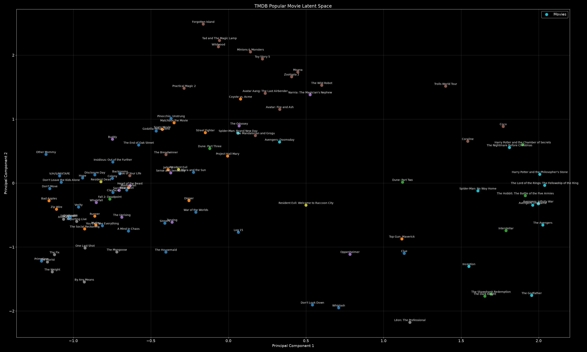
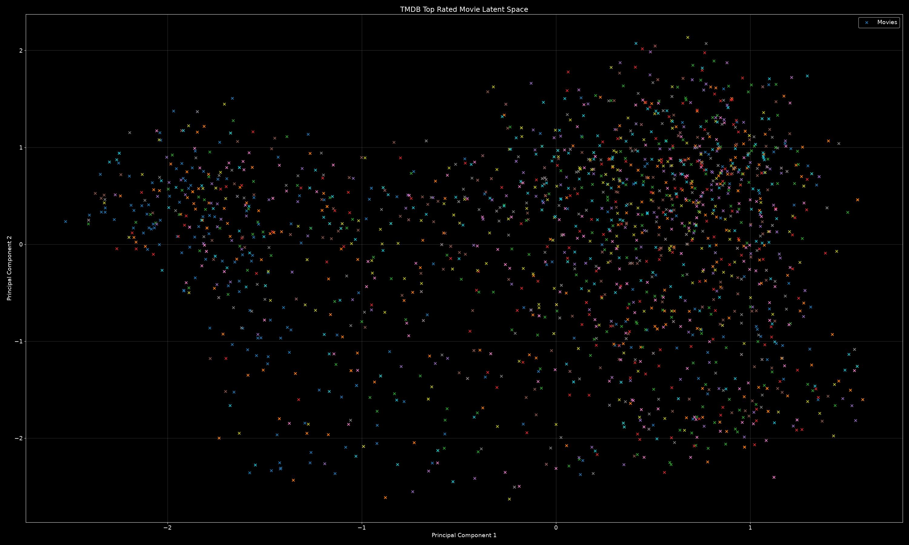
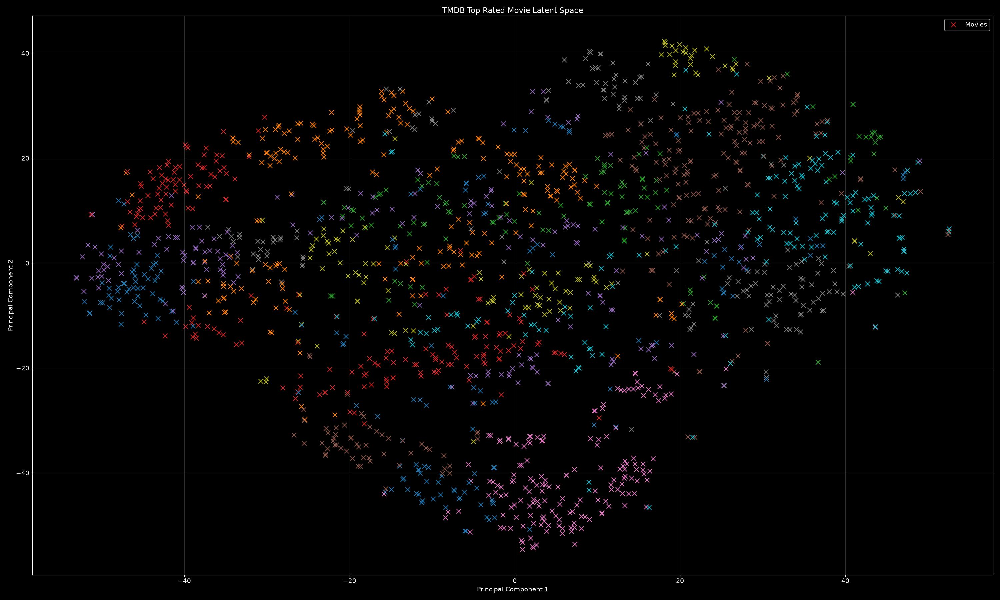
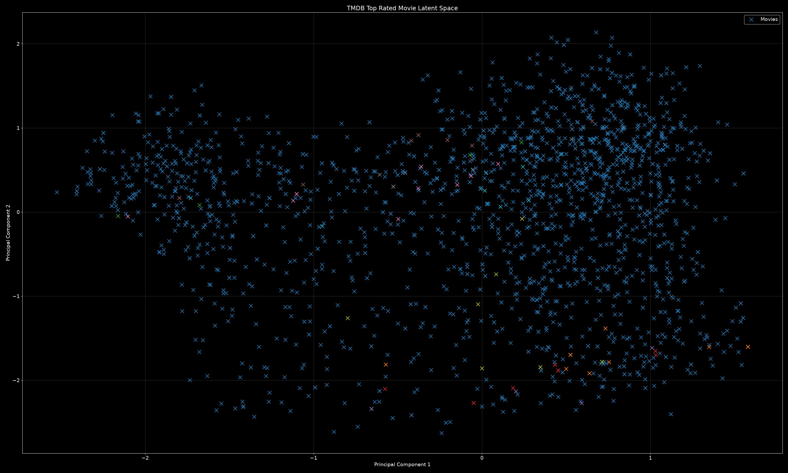
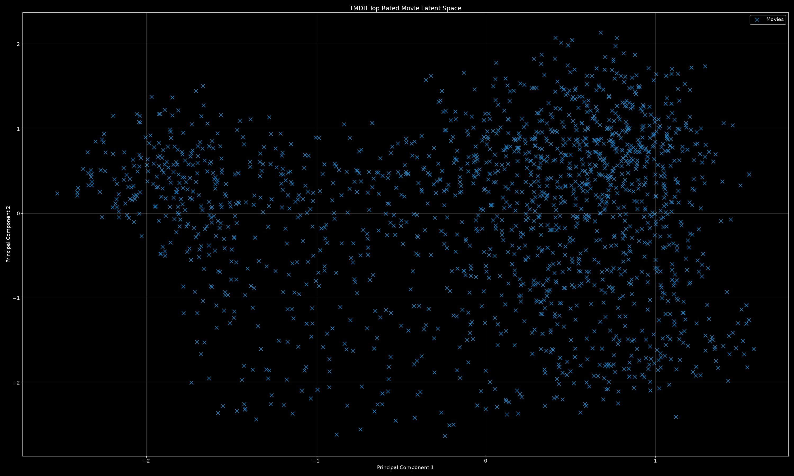

# Movie Clustering

## Inspiration
I found this idea from an instagram reel and thought it looked like a fun project.

## Idea
The idea is to...
- collect movie data using The Movie DataBase (TMDB) API
- produce embeddings on the movies using modern embedding model like gemini-embedding-2
- use unsupervised learning to cluster the movies into groups of similar movies given metric of similarity
- use generative ai to autoproduce semantic labels characterizing the clusters
- possibly cluster the clusters to get subgenres
- produce a local frontend data app to explore the results

## Future Extensions
I have considered using collaborative filtering to produce a reccomendation system based on personal movie ratings. This is probably where I'd like to take the project going forward.

## Main resources
TMDB API (pip install tmdbsimple)
Pandas (pip install pandas)
Google API (pip install google-genai)

## Current State
So far I have explored a few of the pipelines in some jupyter notebooks, and I'm also pulling some movie states, so stay tuned for that.

Here is an image of the current clustering of some movies I have:

## Progress

### collect movie data using The Movie DataBase (TMDB) API
I started by learning to use the tmdb api in a notebook, then I formalized the pipeline in a python file to mount the data.

See "./src/datamount/get-top-rated.py"

### produce embeddings on the movies using modern embedding model like gemini-embedding-2
For my embeddings, I again started by learning how to use the api using a notebook on a small sample dataset. Then, once I was comfortable with the usage, I formalised the embedding pipeline in a python script that I can call to generate embeddings of the top-rated movies, after which I get a scatter plot of their 2D PCA projection.

See "./src/datamount/get-movie-embeddings.py"

### use unsupervised learning to cluster the movies into groups of similar movies given metric of similarity
As I am mostly new to unsupervised learning, I wanted to fokus a little more on this, doing so by testing out a few different models and hyperparameters.

What I decided on, was to make a "clustering" folder, dedicated to testing out different clustering algoritms and hyperparameter setups and seeing what they produce. Maybe I can use this later too see if the clusters were different in more ways than geometric. Perhaps this will become more apparent after auto-labeling the clusters too.

So far I have implemented KMeans to a success, and am starting on DBSCAN, but not to as much success currently.

KMeans (K=30) clustering:

DBSCAN (eps=0.5) clustering:

Actually I couldn't get DBSCAN to work whatsoever, even after trying different preprocessing kinds. I read that it struggles a lot with the curse of dimensionality, so I tried dimensionality reduction with PCA but it just made it worse, classifying all points as noise or the same class.

### use generative ai to autoproduce semantic labels characterizing the clusters
TODO

### possibly cluster the clusters to get subgenres
TODO

### produce a local frontend data app to explore the results
TODO

